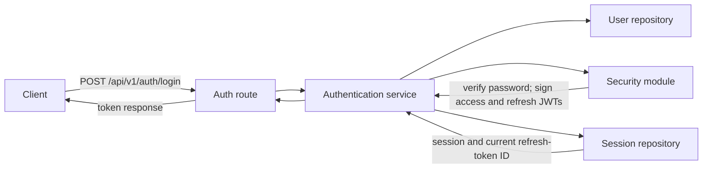

# AuthShield — Authentication and Session Management Backend

AuthShield is a learning-focused authentication backend built with Python and FastAPI. It demonstrates how common authentication pieces fit together: account registration, password hashing, JWTs, sessions, refresh-token rotation, email verification, and password reset.

The project is intended for learning and experimentation. Its current repositories store data in process memory, and several important security and operational safeguards are incomplete. **AuthShield is not production-ready.**

## Table of Contents

- [Project Overview](#project-overview)
- [Technology Stack](#technology-stack)
- [Features and Implementation Status](#features-and-implementation-status)
- [Project Structure](#project-structure)
- [Architecture](#architecture)
- [Authentication Workflows](#authentication-workflows)
- [API Endpoints](#api-endpoints)
- [Installation and Setup](#installation-and-setup)
- [Environment Variables](#environment-variables)
- [Postman Testing Guide](#postman-testing-guide)
- [Security Design](#security-design)
- [Known Limitations](#known-limitations)
- [Roadmap](#roadmap)
- [Contribution and Learning](#contribution-and-learning)
- [License](#license)

## Project Overview

AuthShield is a small backend for exploring authentication concepts and their implementation in a FastAPI application. The code separates HTTP routes, request schemas, authentication services, security helpers, and in-memory repositories so it is easier to see how those responsibilities relate.

The current application exposes versioned endpoints below `/api/v1`. It supports basic registration, login, JWT access and refresh tokens, an authenticated profile endpoint, logout, email verification, and password reset. The implementation is deliberately educational: persistence, token-consumption rules, deployment controls, and other production protections still need to be designed, implemented, and verified.

## Technology Stack

| Technology | Use |
|---|---|
| Python | Application language |
| FastAPI | HTTP API framework and interactive API documentation |
| PyJWT | Signing and validating JSON Web Tokens |
| Pydantic | Request data validation and schema definitions |
| `pwdlib` | Password hashing and password verification |
| `python-dotenv` | Loading environment variables from a local `.env` file |
| UUID | Unique user, session, and token identifiers |
| Postman | Optional manual API testing client |

PostgreSQL integration is planned but has **not** been completed. The current repositories use Python dictionaries and sets in memory. There is no dependency lockfile or requirements file in the repository at this time.

## Features and Implementation Status

The statuses below describe the current code, not a production-readiness guarantee.

| Feature | Status | Notes |
|---|---|---|
| User registration | Basic implementation | Checks for an existing email, hashes the password, creates an in-memory user, and returns a verification token. |
| Password hashing and verification | Implemented | Uses `pwdlib` for hashing and login-time verification. |
| Login with email and password | Basic implementation | Checks the password and requires the account's email to be verified before creating a session and tokens. |
| JWT access tokens | Implemented | Signed access tokens include a subject, expiration, token type, token ID (`jti`), and session ID (`sid`). |
| JWT refresh tokens | Basic implementation | Refresh tokens are checked against the session's current refresh-token ID. |
| Protected profile endpoint | Partial | Uses Bearer-token authentication and checks JWT validity, token revocation, and that the user exists. It does **not** currently confirm that the token's session is active. |
| FastAPI dependencies and Bearer authentication | Implemented | `OAuth2PasswordBearer` extracts the Bearer token and `get_current_user` validates it. |
| Session management | Basic implementation | Sessions are kept in process memory and associated with refresh-token state. |
| Logout and token revocation | Partial | Logout records the access-token ID as revoked and marks its session revoked. Protected requests currently do not check the session's revoked state. |
| Refresh-token rotation | Basic implementation | A successful refresh creates new tokens and replaces the session's current refresh-token ID. |
| Refresh-token reuse detection | Basic implementation | Previously rotated refresh-token IDs are retained in in-memory session history; detection revokes that session. |
| Email verification | Basic implementation | A signed, expiring verification token can mark an existing user as verified. Tokens are not tracked as consumed. |
| Forgot password | Basic implementation | Creates and returns a signed, expiring reset token for a known email address. |
| Reset password | Partial | Validates the token and updates the password hash on the in-memory user record. Token reuse prevention and session revocation are not implemented. |

These features may require further implementation, testing, or hardening. In particular, password-reset token reuse prevention, email-verification token reuse prevention, persistent storage, session checks on protected requests, and other production security measures remain incomplete or unverified.

## Project Structure

The repository keeps the application under `Backend/`. The outline below reflects the intended logical layout and the files currently present; some files may be empty, minimal, or need additional implementation. In particular, `core/config.py`, `services/session_service.py`, and `schemas/user.py` exist but are not currently the main implementation paths.

```text
AuthShield/
├── Backend/
│   ├── .env                         # Local environment variables (do not commit secrets)
│   └── app/
│       ├── main.py
│       ├── api/
│       │   └── v1/
│       │       ├── router.py
│       │       ├── dependencies.py
│       │       └── routes/
│       │           ├── auth.py
│       │           ├── users.py
│       │           └── admin.py
│       ├── core/
│       │   ├── config.py
│       │   └── security.py
│       ├── schemas/
│       │   ├── auth.py
│       │   └── user.py
│       ├── repositories/
│       │   ├── user_repository.py
│       │   ├── token_repository.py
│       │   └── session_repository.py
│       ├── services/
│       │   ├── auth_service.py
│       │   └── session_service.py
│       └── tests/
│           ├── test_auth.py
│           ├── test_security.py
│           ├── test_token.py
│           └── test_users.py
├── .gitignore
├── LICENSE
└── README.md
```

### Directory and file responsibilities

| Path | Purpose |
|---|---|
| `Backend/app/main.py` | Creates the FastAPI application, mounts the versioned API router, and exposes a root status endpoint. |
| `Backend/app/api/v1/router.py` | Collects the authentication, user, and admin routers under the `/api/v1` prefix. |
| `Backend/app/api/v1/routes/auth.py` | Defines registration, login, refresh, logout, email-verification, and password-reset HTTP endpoints. |
| `Backend/app/api/v1/routes/users.py` | Defines the authenticated `/users/me` profile endpoint. |
| `Backend/app/api/v1/routes/admin.py` | Currently exposes an admin status endpoint; it does not implement admin authorization or permissions. |
| `Backend/app/api/v1/dependencies.py` | Extracts the OAuth2 Bearer token, decodes the access token, checks token revocation, and loads the current user. |
| `Backend/app/schemas/auth.py` | Defines Pydantic request/response data models used by parts of the authentication API. Some routes still accept untyped dictionaries. |
| `Backend/app/schemas/user.py` | Intended location for user-related schemas; it may need additional implementation. |
| `Backend/app/core/security.py` | Implements password hashing and verification, and creates and decodes typed, expiring JWTs. |
| `Backend/app/core/config.py` | Intended location for application configuration; the current security module reads `SECRET_KEY` directly from the environment. |
| `Backend/app/repositories/user_repository.py` | Creates and looks up users and changes email-verification state in an in-memory dictionary. |
| `Backend/app/repositories/session_repository.py` | Creates, looks up, and revokes in-memory sessions and tracks refresh-token IDs and history. |
| `Backend/app/repositories/token_repository.py` | Tracks revoked access-token IDs in an in-memory set. |
| `Backend/app/services/auth_service.py` | Coordinates registration, login, password-reset token creation, and password changes. |
| `Backend/app/services/session_service.py` | Intended location for session business logic; the current route/service code uses the session repository directly. |
| `Backend/app/tests/` | Contains test modules. Test coverage and test-suite results have not been verified for this README. |
| `Backend/.env` | Local-only environment configuration. Create it for development and never commit real secrets. |
| `.gitignore` | Lists files and directories Git should ignore. Confirm that local environment files and virtual environments are excluded before committing. |
| `LICENSE` | Contains the project's MIT License. |

## Architecture

The layers divide the request lifecycle into manageable responsibilities:

- **Routes** receive HTTP requests, call application logic, and return HTTP responses.
- **Schemas** validate structured request data and can describe response data. Some current routes still use plain dictionaries instead.
- **Services** coordinate authentication business logic, such as checking a user's password and creating tokens.
- **Security** hashes and verifies passwords and signs and validates JWTs.
- **Repositories** read and write user, session, and token-related data. They currently use in-memory collections.
- **Dependencies** extract and validate authentication context before a protected route runs.

The following diagram shows a simplified login request. Login uses the user repository to find the account, the security module to verify its password and create JWTs, and the session repository to create and associate session state.



## Authentication Workflows

These workflows describe the current design at a high level. Where the implementation is incomplete, that is called out explicitly.

### Registration

1. The registration route receives a username, email, and password.
2. The authentication service looks up the email and rejects an existing account.
3. The password is hashed using `pwdlib`; the plaintext password is not stored.
4. The user repository stores a new user in memory with `is_email_verified` set to `false`.
5. The service creates a signed email-verification token and currently includes it in the response.

The token is for development/testing only in the current flow. A production design should deliver it through a verified email channel and track whether it has already been consumed.

### Login

1. The service finds the user by email.
2. It verifies the submitted password against the stored password hash.
3. It rejects the login if the email has not been verified.
4. It creates a new in-memory session with a UUID.
5. It creates an access token and a refresh token containing the user and session identifiers.
6. It stores the refresh token's `jti` as the session's current refresh-token ID.
7. It returns the user summary and both tokens to the caller.

### Protected routes

1. `OAuth2PasswordBearer` extracts the token from the `Authorization: Bearer <token>` header.
2. The dependency decodes the JWT, which validates its signature and expiration, and checks that its token type is `access`.
3. It requires the token to contain a subject (`sub`), token ID (`jti`), and session ID (`sid`).
4. It checks the in-memory revoked-token set and loads the user by ID.
5. The route runs with that user as its authenticated context.

**Current gap:** the dependency does not load or validate the session identified by `sid`. As a result, marking a session revoked at logout does not by itself cause every protected request to fail; access-token revocation is checked, but session revocation is not.

### Refresh-token rotation

1. The refresh route decodes the supplied refresh token and checks its type and expiration.
2. It reads the token's user ID, session ID, and `jti`, then checks that the session exists and is not marked revoked.
3. If the `jti` is in the session's prior-token history, the route treats it as reuse, revokes the session, and rejects the request.
4. Otherwise, it checks that the token's `jti` matches the current refresh-token ID for the session and that the user still exists.
5. It creates a new access token and refresh token, records the previous refresh-token ID in session history, and stores the new token ID as current.
6. It returns the replacement token pair.

The history and current token ID exist only in process memory. Multi-process deployments, restarts, and concurrent refresh requests are not safely coordinated by this implementation.

### Logout

1. The logout route requires a valid access token and current user.
2. It adds the access token's `jti` to the in-memory revoked-token set.
3. It marks the token's session as revoked.
4. It returns a success message.

Because protected-route dependencies do not currently check the session's revoked flag, session revocation is not consistently enforced across all protected requests.

### Email verification

1. Registration creates a signed verification JWT with an email-verification token type and a 15-minute expiration.
2. The client submits the token to the verification endpoint.
3. The endpoint decodes it, checks the token type and expiration, and uses the subject to find the user.
4. The user repository sets `is_email_verified` to `true`.

The current endpoint uses the `refresh_token` JSON field to carry the verification token. Verification tokens are not recorded as consumed, so token reuse prevention is incomplete.

### Password reset

1. The forgot-password endpoint receives an email address and looks up the user.
2. For a known user, the service creates a signed password-reset JWT with a 15-minute expiration and returns it in the response.
3. The reset-password endpoint receives the token and a new password.
4. The service validates the token's signature, expiration, and type, finds the user, hashes the new password, and updates the in-memory user record.

The current implementation does not consume reset tokens after use, prevent their reuse, or revoke existing sessions after a password change. Returning reset tokens directly in API responses is development-only behavior.

## API Endpoints

The API router is mounted at `/api/v1`. The examples below use sample values only; they are illustrative and are not credentials or tokens. Exact request schemas and response fields should be checked against the current implementation.

| Method | Endpoint | Purpose |
|---|---|---|
| `POST` | `/api/v1/auth/register` | Register a user and create an email-verification token. |
| `POST` | `/api/v1/auth/login` | Authenticate a verified user and create a session and token pair. |
| `POST` | `/api/v1/auth/refresh` | Validate a refresh token, rotate it, and obtain new tokens. |
| `POST` | `/api/v1/auth/logout` | Revoke the current access-token ID and mark its session revoked. |
| `POST` | `/api/v1/auth/verify-email` | Validate an email-verification token and verify the account. |
| `POST` | `/api/v1/auth/forgot-password` | Request a password-reset token. |
| `POST` | `/api/v1/auth/reset-password` | Set a new password using a reset token. |
| `GET` | `/api/v1/users/me` | Get the authenticated user's profile. |

### Request and response examples

#### `POST /api/v1/auth/register`

Request:

```json
{
  "username": "sample_user",
  "email": "user@example.test",
  "password": "example-password"
}
```

Successful response (the verification token is currently returned for development/testing):

```json
{
  "id": "sample-user-uuid",
  "username": "sample_user",
  "email": "user@example.test",
  "verification_token": "sample-verification-token"
}
```

Important failures include an email that is already registered (`400`) and missing or invalid input. The route currently accepts a plain dictionary, so validation is less explicit than the Pydantic models suggest.

#### `POST /api/v1/auth/login`

Request:

```json
{
  "email": "user@example.test",
  "password": "example-password"
}
```

Successful response:

```json
{
  "id": "sample-user-uuid",
  "username": "sample_user",
  "email": "user@example.test",
  "access_token": "sample-access-token",
  "refresh_token": "sample-refresh-token",
  "token_type": "bearer"
}
```

Important failures include invalid email/password and an unverified email (`401`).

#### `POST /api/v1/auth/refresh`

Request:

```json
{
  "refresh_token": "sample-refresh-token"
}
```

Successful response:

```json
{
  "access_token": "sample-new-access-token",
  "refresh_token": "sample-new-refresh-token",
  "token_type": "bearer"
}
```

Important failures include an invalid or expired token, missing or revoked session, a token that is not the session's current refresh token, a missing user, or detected reuse (`401`). Detected reuse revokes the in-memory session.

#### `POST /api/v1/auth/logout`

No JSON body is required. Send the access token using Bearer authorization.

Successful response:

```json
{
  "message": "Successfully logged out"
}
```

Important failures include a missing, invalid, expired, or revoked access token (`401`).

#### `POST /api/v1/auth/verify-email`

Request (the current schema names this field `refresh_token`, although it contains a verification token):

```json
{
  "refresh_token": "sample-verification-token"
}
```

Successful response:

```json
{
  "message": "Email verified succesfully",
  "is_email_verified": true
}
```

Important failures include an invalid or expired token and a user that cannot be found (`401`).

#### `POST /api/v1/auth/forgot-password`

Request:

```json
{
  "email": "user@example.test"
}
```

Successful response (the reset token is currently returned for development/testing):

```json
{
  "message": "password reset token generated",
  "reset_token": "sample-password-reset-token"
}
```

An unknown email currently produces a `400` response. A production implementation should avoid leaking whether an account exists.

#### `POST /api/v1/auth/reset-password`

Request:

```json
{
  "token": "sample-password-reset-token",
  "new_password": "example-new-password"
}
```

Successful response:

```json
{
  "message": "Password has reset successfully"
}
```

Important failures include an invalid or expired token and a user that cannot be found (`400`). The request schema requires a new password of at least eight characters.

#### `GET /api/v1/users/me`

No JSON body is required. Include a valid access token in the `Authorization` header.

Successful response:

```json
{
  "id": "sample-user-uuid",
  "username": "sample_user",
  "email": "user@example.test"
}
```

Important failures include a missing, invalid, expired, or revoked access token, a malformed token payload, or a missing user (`401`).

## Installation and Setup

### 1. Clone the repository

Replace `<REPOSITORY_URL>` with the repository URL you use; no repository URL is assumed here.

```bash
git clone <REPOSITORY_URL>
cd AuthShield
```

### 2. Enter the backend directory and create a virtual environment

Windows PowerShell:

```powershell
cd Backend
python -m venv .venv
```

Ubuntu/Linux:

```bash
cd Backend
python3 -m venv .venv
```

### 3. Activate the virtual environment

Windows PowerShell:

```powershell
.\.venv\Scripts\Activate.ps1
```

If PowerShell prevents script activation, use Command Prompt instead:

```bat
.venv\Scripts\activate.bat
```

Ubuntu/Linux:

```bash
source .venv/bin/activate
```

### 4. Install dependencies

There is currently no `requirements.txt` or other dependency manifest in the repository. Install the packages used by the application into the activated virtual environment:

```bash
python -m pip install fastapi "uvicorn[standard]" PyJWT pydantic "pwdlib[argon2]" python-dotenv email-validator
```

`email-validator` is needed for Pydantic's `EmailStr` support. `pwdlib[argon2]` provides a password-hashing backend for the recommended password hasher. Postman is optional and installed separately as a desktop app or browser tool.

### 5. Create a local `.env` file

From the `Backend` directory, create a file named `.env` and add a securely generated `SECRET_KEY` as described in [Environment Variables](#environment-variables). Keep this file local and out of version control.

Windows PowerShell can create an empty file with:

```powershell
New-Item -ItemType File -Path .env
```

Ubuntu/Linux:

```bash
touch .env
```

Open the file in a text editor and add:

```dotenv
SECRET_KEY=replace_with_a_secure_random_value
```

### 6. Start the development server

From the `Backend` directory with the virtual environment active:

```bash
uvicorn app.main:app --reload
```

The local server normally listens at `http://127.0.0.1:8000`. The `--reload` option is for local development, not production deployment.

### 7. Open the interactive API documentation

Visit:

- Swagger UI: `http://127.0.0.1:8000/docs`
- ReDoc: `http://127.0.0.1:8000/redoc`

## Environment Variables

The application reads `SECRET_KEY` in `Backend/app/core/security.py`:

```dotenv
SECRET_KEY=your_secure_random_secret
```

Generate a value locally using Python:

```bash
python -c "import secrets; print(secrets.token_urlsafe(64))"
```

Copy the generated value into the local `.env` file. Do not copy the example placeholder above as the real secret. Never commit the actual secret to Git, paste it into issue reports, or expose it in logs. Configure the secret through the deployment environment in any deployed setup. Rotating the signing key invalidates tokens signed with the old key.

## Postman Testing Guide

Start the backend and create a Postman collection with the base URL `http://127.0.0.1:8000`. Use `Content-Type: application/json` and the **raw → JSON** body mode for JSON request bodies.

1. **Register a user.** Send `POST /api/v1/auth/register` with `username`, `email`, and `password`.
2. **Verify the email.** For the current development flow, copy `verification_token` from the registration response and send it as the `refresh_token` property to `POST /api/v1/auth/verify-email`.
3. **Log in.** Send `POST /api/v1/auth/login` with the same email and password. Copy the returned `access_token` and `refresh_token`.
4. **Call the profile endpoint.** Send `GET /api/v1/users/me`. In Postman's **Authorization** tab, choose **Bearer Token** and paste the access token.
5. **Refresh the tokens.** Send `POST /api/v1/auth/refresh` with the current refresh token in a JSON body. Save the new access and refresh tokens; the old refresh token should no longer be the current one.
6. **Log out.** Send `POST /api/v1/auth/logout` with the current access token under **Authorization → Bearer Token**.
7. **Check revocation behavior.** Try the profile request with the logged-out access token. The access-token revocation check should reject that token. Session revocation is stored, but protected routes do not currently check the session's revoked flag.
8. **Request a password-reset token.** Send `POST /api/v1/auth/forgot-password` with the account email and copy the returned token.
9. **Reset the password.** Send `POST /api/v1/auth/reset-password` with the reset token and a new password.
10. **Test the new password.** Log in using the new password.

**Development-only behavior:** verification and password-reset tokens are currently returned directly in API responses to make local testing possible. Do not use this token-delivery approach in a public or production service; send tokens through an appropriate delivery channel and avoid exposing them in API responses or logs.

## Security Design

- **Password hashing:** Passwords are transformed into one-way hashes before storage. Login verifies a candidate password against the hash rather than decrypting or retrieving a plaintext password.
- **JWT signing and validation:** The server signs JWTs with `SECRET_KEY`. Decoding validates the signature and expiration; a token with an invalid signature or expired `exp` claim should be rejected.
- **Access token versus refresh token:** Access tokens authorize API requests and have a shorter lifetime. Refresh tokens are used to request replacement tokens and are associated with a server-side session record.
- **Token expiration:** The current code sets access tokens to 30 minutes, refresh tokens to 7 days, and email-verification and password-reset tokens to 15 minutes. These values are implementation defaults, not a claim that the policy is appropriate for production.
- **Token type validation:** JWTs carry a `type` claim. The decode helpers check that an access, refresh, verification, or reset token is being used for its intended purpose.
- **Session management:** Login creates a session with a UUID. The session tracks whether it is revoked, its current refresh-token ID, and previously used refresh-token IDs. The state is currently in memory.
- **Token revocation:** Logout records the access token's ID (`jti`) as revoked. This check is also in memory, so revocation does not persist across restarts or synchronize between application workers.
- **Refresh-token rotation:** A successful refresh replaces the session's current refresh-token ID with the new token's ID and moves the previous ID into session history.
- **Refresh-token reuse detection:** A refresh token found in the prior-token history is treated as reused and causes the session to be revoked. This protection depends on in-memory state and requires further testing for concurrent requests and multi-worker use.
- **Email verification:** A short-lived, signed token proves possession of a verification link in the intended workflow. Current tokens are not consumed or stored as single-use credentials, and token delivery is not implemented.
- **Password-reset tokens:** A short-lived, signed token authorizes a password change. The current flow does not consume the token after a reset, prevent reuse, revoke existing sessions, or deliver the token through email.

## Known Limitations

- **In-memory storage is not persistent.** Users, sessions, and revocation data are lost when the process restarts.
- **In-memory state is not shared.** Multiple server workers or machines will have different user, session, and revocation collections, so authentication behavior can become inconsistent.
- **Session revocation is not enforced by the protected-route dependency.** The dependency checks access-token revocation but does not check the session's revoked flag.
- **Reset and verification tokens are not single-use.** The current implementation does not persist token consumption state.
- **Password reset does not revoke active sessions.**
- **Tokens are returned by verification and password-reset API responses.** This is a local development convenience, not safe token delivery for a public service.
- **Password-reset account lookup may disclose whether an email is registered.**
- **Request validation is inconsistent.** Some endpoints accept plain dictionaries even though Pydantic models exist.
- **The secret is read directly from the environment.** Configuration validation, startup checks, key rotation, and production secret management need further work.
- **No production deployment configuration or security hardening is included.** HTTPS termination, rate limiting, monitoring, abuse controls, and operational procedures are not established here.
- **Automated test coverage and test results are not asserted by this README.** Review and run the test modules against the current code before relying on behavior.

These limitations mean that the project should be used for learning and local experimentation, not as-is for real accounts or sensitive data.

## Roadmap

The following work is planned or incomplete and should not be read as implemented:

- [ ] Enforce single-use password-reset tokens.
- [ ] Enforce single-use email-verification tokens.
- [ ] Revoke active sessions after a password reset.
- [ ] Integrate PostgreSQL for persistent user data.
- [ ] Persist session state and token revocations.
- [ ] Add and verify automated `pytest` coverage for authentication and security behavior.
- [ ] Implement role-based access control.
- [ ] Add authorization and permissions to admin-only routes.
- [ ] Add rate limiting and abuse protections.
- [ ] Add real email delivery for verification and reset links.
- [ ] Improve request validation, error handling, and account-enumeration resistance.
- [ ] Complete production deployment and security hardening.

## Contribution and Learning

AuthShield is a learning project focused on authentication architecture, FastAPI, and backend security. Contributions that improve correctness, documentation, test coverage, or security design are welcome.

A simple contribution workflow:

1. Fork or clone the repository.
2. Create a branch for a focused change.
3. Make the change and add or update tests where appropriate.
4. Run relevant checks locally and document anything that remains unverified.
5. Open a pull request describing the change and its impact.

Do not include real credentials, tokens, personal information, or local `.env` files in commits or examples.

## License

The repository currently includes an [MIT License](./LICENSE). If the project license changes, update this section to match the license that has actually been selected and committed.
